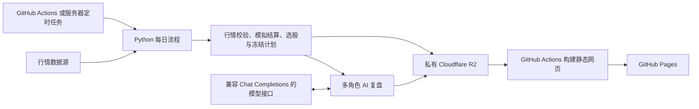

# 无名游资 A 股 AI 模拟交易系统

基于「无名游资 A股AI交易系统 V2」改造的每日研究系统：自动采集行情、按固定规则选股、维护模拟账户、召开多角色 AI 复盘会议，并把结果发布到 GitHub Pages。

当前云端策略版本为 `v2.1-cloud1`。原始项目署名为 **bilibili 无名游资**。本项目只维护虚拟账户，不连接券商或执行真实交易；AI 负责分析和提出研究建议，不自动修改交易规则。

[查看复盘网站](https://chufanchen.github.io/stock-cloud-repository/) · [GitHub Actions](https://github.com/chufanchen/stock-cloud-repository/actions) · [AI 会议说明](cloud/MEETING.md) · [TickFlow 与竞价数据说明](cloud/TICKFLOW.md)

## 1. 项目能做什么

| 功能 | 当前实现 |
|---|---|
| 每日行情 | 校验当天收盘快照，补齐缺失历史日线；支持数据源优先级和自动回退 |
| 固定规则选股 | 筛选收盘涨停、非 ST/退市、至少120条历史日线、120日价格区间位置低于10%的候选 |
| 模拟结算 | 使用交易日前冻结的计划，检查开盘条件、竞价流动性、现金和持仓，计算模拟手续费与收益 |
| 多角色复盘 | 四席独立分析、一席交叉审计、主持人汇总，通常每天六次成功模型调用 |
| 共享记忆与提案 | 保存跨天共享/角色记忆、待验证研究提案；`auto_apply` 固定为 `false` |
| 持久化与恢复 | R2 保存行情、账户、计划、报告和会议；失败后从检查点续跑 |
| 静态网站 | GitHub Pages 展示总览、历史日报、AI 发言与研究提案 |

多角色是同一套事实上的分析分工，不是多个独立交易账户，也不等于模型训练或自动策略进化。研究提案不会自动进入交易引擎。

## 2. 运行架构



每日计算只选一个主执行端。GitHub Pages 的发布任务独立运行，不采集行情、不调用 AI、不修改账户。当前没有 Cloudflare Worker 执行程序，Cloudflare 在此方案中提供 R2 存储。

## 3. 代码结构

```text
.
├── README.md                       项目总览、部署和日常操作入口
├── CLOUD_START.md                  部署文档导航
├── .gitignore                     排除密钥、账本、数据库和原始研究资料
├── .github/workflows/
│   ├── daily.yml                  每日模拟结算、选股、AI会议；支持手动补跑
│   ├── research-check.yml         公开研究接口检查，不读写账户/R2或调用AI
│   ├── sources-check.yml          TickFlow 样本接口检查，不读写账户
│   ├── pages.yml                  从 R2 读取报告并发布 Pages
│   └── test.yml                   自动化测试
└── cloud/
    ├── ashare_cloud/
    │   ├── cli.py                 init/bootstrap/run/review/sync/status/restore 入口
    │   ├── runner.py              服务器入口：进程锁、独立恢复目录、运行记录
    │   ├── common.py              配置校验、北京时间、交易日历、哈希与JSON工具
    │   ├── market.py              股票池、收盘快照、历史补齐、竞价与选股
    │   ├── auction.py             免Key腾讯早盘快照、双样本校验与独立R2证据
    │   ├── history.py             历史日线适配器、限速、重试与时间预算
    │   ├── sources.py             按用途配置的来源优先级、回退与有效性检查
    │   ├── tickflow.py            TickFlow REST适配、批量请求与脱敏诊断
    │   ├── source_check.py        TickFlow独立检查入口
    │   ├── engine.py              固定交易规则、模拟费用、账户和冻结计划
    │   ├── storage.py             R2状态包、数据库校验和条件写入
    │   ├── research_data.py        研究资料采集、同日归档、摘要和独立检查
    │   ├── research_sources.py     龙虎榜、行业、新闻、公告、财务等适配器
    │   ├── review.py              模型接口、事实摘要与日报生成
    │   ├── meeting.py             多角色会议、断点恢复、记忆与提案
    │   └── pages.py               只读生成公开静态网站
    ├── config.json                行情及模拟交易参数
    ├── meeting.json               角色职责、模型覆盖与输出额度
    ├── research_data.json         研究来源、抓取预算和关注股票上限
    ├── meeting_seed.json          初始研究记忆及来源
    ├── .env.example               环境变量模板，不含真实密钥
    ├── requirements.lock          每日流程的固定依赖版本
    ├── pages-requirements.txt      网页构建所需依赖
    ├── export_repository.py       从完整本地包导出代码和文档
    ├── deploy/                    Linux systemd service/timer
    ├── web/                       静态网页样式与脚本
    ├── tests/                     交易、行情、存储、会议和网页测试
    ├── SERVER.md                  服务器部署与维护补充
    ├── PAGES.md                   网页发布与公开内容说明
    ├── MEETING.md                 角色、记忆和研究提案机制
    ├── AUCTION.md                 无Tushare权限时的早盘采样与回退部署
    └── TICKFLOW.md                数据源配置、诊断和竞价边界
```

Documents 中的完整迁移包还保留 `大投机家利弗莫尔/`、`AI进化初始版/`、`最强AI/`、`德国股神科斯托拉尼/`、`股神巴菲特A股交易/` 和 `_共享依赖/`。它们是原始代码、资料和数据快照，默认不上传到本代码仓库；自动化入口统一使用 `cloud/`。

**仅克隆 GitHub 仓库不会获得原始行情数据库、私有 R2 状态或密钥。** 首次初始化需要完整本地包；已有 R2 时直接恢复。

## 4. 每日流程与数据源

一次 `run` 按顺序执行：

1. 按北京时间和 XSHG 交易日历检查日期；休市日跳过。
2. 从 R2 恢复最新账户、冻结计划和行情数据库。
3. 获取收盘快照，补历史缺口，检查有效日期、价格及覆盖率。
4. 按已有计划模拟结算并保存账户；首次空仓运行不会倒推当天买入计划。
5. 选出下一交易日候选，在允许的日期范围内冻结计划并保存。
6. 调用多角色 AI 会议，逐席保存进度，生成日报、记忆和研究提案。
7. 网页工作流从 R2 读取结果并发布。

| 用途 | 默认优先级 | 说明 |
|---|---|---|
| 历史日线 | TickFlow → 新浪 → 东方财富 | TickFlow 显式请求 `adjust=none`；独立历史来源只补缺行，需与归档当天 OHLC 一致 |
| 当日收盘行情 | TickFlow → 腾讯 | 按股票回退，校验当天日期及北京时间15:00后的时间戳 |
| 开盘集合竞价额 | Tushare `stk_auction_o` → 腾讯早盘归档快照 | 前者需权限；后者需早盘现场采集并通过校验，口径为保守推定金额 |

优先级在 [cloud/config.json](cloud/config.json) 中配置：

```json
{
  "history_sources": ["tickflow", "sina", "eastmoney"],
  "quote_sources": ["tickflow", "tencent"],
  "auction_sources": ["tushare", "tencent_snapshot"],
  "tickflow_batch_size": 50,
  "quote_budget_seconds": 600
}
```

这是配置片段，修改对应字段即可，不要用它覆盖完整配置。未填 TickFlow Key 时会跳过该源；无权限、冷却中、请求失败或数据不合格时按优先级处理。最终仍须满足97%的完整历史覆盖要求，回退不会降低门槛。

历史抓取默认2个线程、全局最小间隔1秒、40分钟预算；批量接口减少请求数量。中断前保存历史缺口和诊断，之后只继续未完成部分。401/403会停用被拒绝的来源，429遵守其冷却期。

**无 Tushare 竞价权限时，可使用免Key腾讯早盘快照回退。** 新采集器参考原 `watch_auction.py`，在北京时间09:25:05至09:29:50保存同日、同一冻结计划的双样本，验证时间戳和量额关系后保守推定竞价额。早盘由本机或服务器采集到私有R2，晚间Actions读取；漏采不能补造。采集器代码及systemd模板已提供，尚未启用定时或验证真实早盘样本。详见 [竞价回退部署](cloud/AUCTION.md)。TickFlow普通行情仍不自动用作竞价证据。

新会议会在结算保存后采集十类盘后研究数据，包括龙虎榜及席位、涨跌停池、行业资金流、题材、快讯、公司公告索引和财务三表摘要。无需新增密钥，缺失和有限覆盖显式展示；已有会议保留冻结输入，不用当前资料补造历史。配置、角色分工和接口检查见 [研究数据接入](cloud/RESEARCH_DATA.md)。

## 5. 部署准备：代码、Python 与配置

### 5.1 取得代码并安装依赖

如果已有 Documents 完整项目，直接进入该目录，不必再次克隆：

```bash
cd "$HOME/Documents/无名游资A股AI交易系统V2版本"
```

在新机器上获取代码：

```bash
git clone https://github.com/chufanchen/stock-cloud-repository.git
cd stock-cloud-repository
```

后续本地命令均在项目根目录运行。使用 **Python 3.14**，与当前工作流及依赖锁保持一致：

```bash
python3.14 -m venv .venv
source .venv/bin/activate
python -m pip install -r cloud/requirements.lock
export PYTHONPATH="$PWD/cloud"
```

已有 `.venv` 时直接激活并安装依赖。若机器没有 `python3.14`，先安装该版本或使用指向 Python 3.14 的解释器路径；不要只凭 `python3` 命令名判断版本。

### 5.2 创建本机环境文件

```bash
if [ ! -f .cloud.env ]; then
  cp cloud/.env.example .cloud.env
fi
chmod 600 .cloud.env
```

编辑 `.cloud.env`，填写下表字段。程序**不会自动加载**这个文件；本机运行前需执行：

```bash
set -a
source .cloud.env
set +a
```

只加载自己填写的文件，含空格或特殊字符的值使用单引号包围。服务器由 systemd 加载 `/etc/wuming/cloud.env`，GitHub 由 Secrets/Variables 注入，三处配置不会自动同步。

### 5.3 密钥与普通变量

GitHub 配置入口：仓库 **Settings → Secrets and variables → Actions**。

| Secret | 用途 | 是否需要 |
|---|---|---|
| `R2_ACCESS_KEY_ID` | R2 S3 Access Key ID | 每日流程必须 |
| `R2_SECRET_ACCESS_KEY` | 配套的 R2 Secret Access Key | 每日流程必须 |
| `AI_API_KEY` | 通用模型接口密钥 | AI复盘必须 |
| `TICKFLOW_API_KEY` | TickFlow日线与实时行情 | 启用TickFlow需要；缺省走备用来源 |
| `TUSHARE_TOKEN` | 专用开盘竞价接口 | 可选；需要 `stk_auction_o` 权限。无权限可使用腾讯早盘采样回退 |
| `R2_PAGES_ACCESS_KEY_ID` | 单独的R2只读Access Key | 可选，需与下一项同时配置 |
| `R2_PAGES_SECRET_ACCESS_KEY` | 单独的R2只读Secret Key | 可选；未配置时网页任务复用每日流程凭据 |

| Variable | 填写内容 |
|---|---|
| `R2_ENDPOINT_URL` | 桶对应的S3 API端点，例如 `https://<ACCOUNT_ID>.r2.cloudflarestorage.com`；按实际地区端点填写 |
| `R2_BUCKET` | 私有R2桶名 |
| `R2_PREFIX` | 状态前缀，默认 `wuming-v2`；所有执行端必须一致 |
| `AI_BASE_URL` | 兼容接口基础地址，通常以 `/v1` 结尾；程序补上 `/chat/completions` |
| `AI_MODEL` | 服务商支持的模型ID |
| `TICKFLOW_BASE_URL` | 可省略，默认 `https://api.tickflow.org`；不加 `/v1` |
| `DAILY_EXECUTOR` | `github` 使用Actions日常执行；`server` 跳过Actions定时计算；未设置等同使用Actions |

R2端点、桶名、前缀及AI地址/模型名也兼容已有的同名Secrets，Variables优先。`TICKFLOW_BASE_URL` 和 `DAILY_EXECUTOR` 在工作流中从 Variables 读取。

模型服务需要兼容 Chat Completions 的 `messages`、`max_tokens` 及 `choices[0].message.content`，并能返回符合要求的JSON。各角色默认共用同一套AI密钥，可在 [meeting.json](cloud/meeting.json) 中设置角色模型和输出额度。

R2桶保持私有；每日任务使用限定到该桶的 **Object Read & Write** S3凭据，网页可另配 **Object Read** 凭据。这里填的是Access Key ID/Secret Access Key，不是Cloudflare全局API Key。[R2官方认证说明](https://developers.cloudflare.com/r2/api/tokens/)

## 6. 准备 R2 状态：选择符合现状的一条

### 已经有 R2 账户状态

**不要重新执行 `init` 或 `bootstrap`。** 可先做一次只读恢复检查，确认连接与账户状态：

```bash
wuming_state_dir="$(mktemp -d "${TMPDIR:-/tmp}/wuming-inspect.XXXXXX")"
python -m ashare_cloud.cli restore --state-dir "$wuming_state_dir"
python -m ashare_cloud.cli status --state-dir "$wuming_state_dir"
```

`restore` 只下载，`status` 只查看本地恢复结果。后续远端执行每次使用新的空目录；Actions和服务器入口会准备各自的恢复目录。

### 全新部署，尚未初始化 R2

先创建私有R2桶与上述凭据，并在**拥有完整原始包**的机器上运行：

```bash
python -m ashare_cloud.cli init \
  --legacy-root "$PWD/大投机家利弗莫尔" \
  --state-dir .cloud-state-seed
python -m ashare_cloud.cli status --state-dir .cloud-state-seed
python -m ashare_cloud.cli bootstrap --state-dir .cloud-state-seed
```

初始化器需要原包中的 `data/market.db` 和 `data/fills/20261019.json`，核验原快照为空仓、现金为 **100,013.62元**，再提取最近200个市场交易日到独立数据库。它不是任意本金、任意账本的通用导入器；原始账本有持仓或已经变化时会拒绝初始化。

`bootstrap` 仅创建不存在的远端状态。仅有公开代码、没有原始数据也没有既有R2时，不能直接运行每日任务；当前未实现从零下载全市场历史并自动建立账户的入口。

## 7. 方案 A：GitHub Actions 执行每日任务

完成代码上传、R2初始化和仓库密钥配置后：

1. 确保默认分支是 `main`，Actions已启用，`.github/workflows/` 位于仓库根目录。
2. 将仓库 Variable **`DAILY_EXECUTOR` 设置为 `github`**，或删除此前的 `server` 值。
3. 若使用TickFlow，先打开 **Actions → 行情数据源检查 → Run workflow → main**。这是TickFlow专用检查，不会回退后冒充通过，也不会读写账户或调用AI。
4. 在交易日北京时间20:00后，打开 **Actions → A股每日模拟盘 → Run workflow**，选择 `main`、`mode=run`，`trade_date` 留空。
5. 查看日志和 `daily-report-...` 附件，确认行情完整性、结算日期和AI会议状态，再按下一节启用网站。

默认调度如下，时间均为 **北京时间 Asia/Shanghai**，不随执行机器的时区或美国夏令时改变：

| 工作流 | 定时安排 | 手动入口 |
|---|---|---|
| A股每日模拟盘 | 周一至周五20:37；21:37失败补偿 | `mode=run/review/sync` |
| 发布复盘网页 | 周一至周五21:17、22:17、23:17；每日任务结束后也触发 | Run workflow |
| 行情数据源检查 | 不定时运行 | Run workflow |
| 云端模拟盘测试 | cloud代码/文档或工作流相关提交、PR触发 | 无手动入口 |

每日计算由XSHG日历跳过休市日，单次工作流上限55分钟。GitHub定时触发可能延迟；公开仓库长期无活动时定时工作流也可能被停用，应在Actions中检查是否仍启用。[GitHub调度说明](https://docs.github.com/en/actions/reference/workflows-and-actions/events-that-trigger-workflows#schedule)

首次成功执行会记录空仓结算并建立下一交易日计划；之后才依据事前计划模拟交易。缺竞价数据、没有合格候选或规则不允许买入时，可以有正常日报而没有模拟成交。

## 8. 方案 B：自己的服务器执行每日任务

适用于需要常驻进程、统一管理运行环境的场景。使用Linux + systemd；服务器需已安装Python 3.14，并能访问R2、行情和模型服务。GitHub仍负责代码、测试和Pages。

先按前文完成R2初始化。在新服务器上将代码放到 `/opt/wuming`：

```bash
sudo git clone https://github.com/chufanchen/stock-cloud-repository.git /opt/wuming
sudo useradd --system --user-group --home-dir /var/lib/wuming --no-create-home wuming
sudo install -d -o wuming -g wuming -m 700 /var/lib/wuming
sudo python3.14 -m venv /opt/wuming/.venv
sudo /opt/wuming/.venv/bin/python -m pip install -r /opt/wuming/cloud/requirements.lock
sudo install -d -m 700 /etc/wuming
if ! sudo test -f /etc/wuming/cloud.env; then
  sudo install -m 600 /opt/wuming/cloud/.env.example /etc/wuming/cloud.env
fi
sudoedit /etc/wuming/cloud.env
```

已有代码、用户或环境时跳过对应创建步骤。环境文件采用 `KEY=value`，无需 `export`；不要覆盖已经填写的密钥。服务通过R2恢复状态，无需复制Mac的虚拟环境或原始数据库。

在GitHub把 **`DAILY_EXECUTOR=server`** 设为仓库Variable，然后安装服务：

```bash
sudo install -m 644 /opt/wuming/cloud/deploy/wuming-daily.service /etc/systemd/system/
sudo install -m 644 /opt/wuming/cloud/deploy/wuming-daily.timer /etc/systemd/system/
sudo systemctl daemon-reload
sudo systemctl start wuming-daily.service
sudo journalctl -u wuming-daily.service -n 100 --no-pager
```

首次实际执行应在交易日北京时间20:00后。确认行情、结算和会议完成后启用定时：

```bash
sudo systemctl enable --now wuming-daily.timer
systemctl list-timers wuming-daily.timer
```

服务器同样在20:37运行、21:37补偿；每次恢复到 `/var/lib/wuming/runs/<运行编号>/state/`，并有本机进程锁。`DAILY_EXECUTOR=server` 不会替你部署服务器，只会跳过GitHub的定时计算；未启用服务器timer时就没有自动计算端。

只启用一个日常计算端。切回Actions前，先停止服务器timer并确认没有任务仍在运行，再将变量改为 `github`。更多维护操作见 [服务器指南](cloud/SERVER.md)。

## 9. 发布 GitHub Pages

当前仓库为 `chufanchen/stock-cloud-repository`，网站地址为：

**[无名游资复盘台](https://chufanchen.github.io/stock-cloud-repository/)**

设置步骤：

1. 仓库 **Settings → Pages → Build and deployment → Source** 选择 **GitHub Actions**。
2. 保留仓库中的R2配置。若使用独立只读密钥，同时填写两个 `R2_PAGES_*` Secrets。
3. 打开 **Actions → 发布复盘网页 → Run workflow → main**。
4. 等待 `build` 和 `deploy` 均成功，再检查网页的日报日期与AI状态。

Pages不需要AI或行情密钥。无论每日计算在Actions还是服务器上，发布都读取同一个 `R2_BUCKET/R2_PREFIX`。

网站公开展示模拟资金、候选、持仓、成交及AI发言；不发布密钥、原始账户文件、行情数据库或记忆文件。R2私有不意味着生成的网站私有，因此复盘上下文应适合公开展示。当前仓库已采用公开代码部署；在其他私有仓库部署Pages时需要相应账户套餐。[GitHub Pages官方说明](https://docs.github.com/en/pages/getting-started-with-github-pages/using-custom-workflows-with-github-pages)

本地预览（已加载R2环境变量）：

```bash
python -m ashare_cloud.pages --output site-preview-01
python -m http.server 8765 --directory site-preview-01
```

打开 [本地预览](http://localhost:8765/)。输出目录必须不存在或为空；重新生成时换一个目录。已有本地状态时可加 `--state-dir <本地状态目录>` 离线构建。详见 [Pages说明](cloud/PAGES.md)。

## 10. 常用命令与补跑

| 命令/模式 | 作用 | 前提与限制 |
|---|---|---|
| `init` | 从原始包建立独立本地账户 | 仅首次；目标目录为空 |
| `bootstrap` | 首次把本地状态上传R2 | 远端尚未初始化 |
| `restore` | 只读下载R2状态 | 使用新的空目录 |
| `status` | 查看本地账户摘要 | 目录中已有账户；不会自动从R2下载 |
| `run` | 行情、模拟结算、选股、会议及日报 | 当天收盘后；历史补跑需相应归档和合法计划 |
| `review` | 仅补已结算日的AI会议/报告 | 不重做结算或选股；日期必须已结算 |
| `sync` | 只续补已有收盘归档所需的历史行情 | 不结算、不建计划、不调用AI；没有归档时不能执行 |

GitHub手动任务只提供 `run/review/sync`。当天 `run` 日期留空；补会议填实际已结算日期；`sync` 日期留空时使用最新归档收盘快照。

本地或服务器直接调用CLI的示例（分别按需运行，目录名重复使用前检查是否为空）：

```bash
python -m ashare_cloud.source_check
python -m ashare_cloud.cli sync --state-dir .cloud-state-sync-01
python -m ashare_cloud.cli run --state-dir .cloud-state-run-01
```

只补某个已有结算日的会议，把日期替换为实际日期：

```bash
python -m ashare_cloud.cli review --date YYYY-MM-DD --state-dir .cloud-state-review-01
```

`run/review/sync` 默认从R2下载并保存结果；每次传入新的空目录。`--local` 则只用已有本地状态，不读写R2；`--skip-ai` 显式跳过模型调用，不能用来证明AI复盘正常。服务器的 `runner` 会自动创建目录，但目前只支持 `run/review`，`sync` 使用CLI或Actions。

更新代码后，通过 **Run workflow** 启动新任务；旧记录的 **Re-run jobs** 仍基于原提交，不能用于验证新修复。

## 11. 结果保存在哪里

以下路径相对一次运行的状态目录：

```text
account.json                     模拟账户、结算记录、冻结计划及哈希链
market.db                        行情数据库
history-pending.json             尚未补齐的历史区间
snapshots/YYYY-MM-DD.json         当天行情证据与完整性状态
scans/YYYY-MM-DD.json             选股结果
reports/YYYY-MM-DD.{html,md,json} 日报
reviews/YYYY-MM-DD.json           AI复盘状态与汇总
meeting/days/YYYY-MM-DD.{json,md} 会议上下文、逐席结果和断点
meeting/memory/YYYY-MM-DD.json    共享及角色记忆
research/proposals.{json,md}      累计待验证研究提案
diagnostics/                    行情来源、覆盖率与错误分类
auctions/                       同日冻结计划对应的腾讯早盘原始双样本
```

R2使用 `HEAD.json` 指向当前有效状态包及数据库版本，并通过哈希校验和条件写入防止旧任务覆盖新状态。账本以R2为准，Actions缓存、运行附件和Pages都不是唯一账本。

GitHub的 `daily-report-...` 附件包含日报、选股、会议、研究提案及诊断，保留30天；完整账户和数据库在R2。服务器成功运行后会清理该次恢复的本地数据库副本，但保留报告与运行记录，失败目录保留用于排查。

## 12. 日常查看与常见问题

正常部署后不需要每天手工启动。每天查看网站的**日报日期、行情状态、AI状态和未买入原因**；出错时先看相应Actions日志或服务器日志，再选择补跑模式。

| 现象 | 原因或检查方法 |
|---|---|
| Daily为绿色，但没有新报告 | 先看是否休市跳过、`DAILY_EXECUTOR=server` 导致计算任务跳过，或本次选了只补行情的 `sync` |
| R2已有日报，网站仍是旧日期 | 检查“发布复盘网页”的build/deploy；核对R2桶和前缀，手动发布一次 |
| 历史覆盖不足或达到时间预算 | 查看 `history-日期.json` 和总剩余缺口；已有归档时用 `sync` 续补，之后再按账户状态运行 `run` |
| 上一交易日报价覆盖已超过97%，仍失败 | 还需检查完整历史覆盖率和待补区间，单日有报价不等于历史缺口已补齐 |
| TickFlow `http_403` | 查看失败接口和 `response_hint`；确认Key、订阅、接口权限及访问限制，不能只凭403断定具体原因 |
| TickFlow检查失败，但Daily能继续 | 专用检查只验证TickFlow；Daily会按优先级回退，可在诊断里查看实际来源 |
| `AI会议室 ... 未完成` | 结算可能已保存；检查模型权限、兼容接口和输出额度，再用该日 `review` 补未完成席位 |
| 有候选但没有买入 | 检查规则拒绝原因；没有可靠竞价额时不会虚构成交 |
| `R2 恢复目录必须为空` | 换一个新的恢复目录；查看已有状态用 `status`，本地执行用 `--local` |
| 缺少盘前冻结计划或漏交易日 | 不能靠改日期、重置账本或盘后补选股绕过；核对历史归档与计划后另行处理 |

AI会议每席成功后保存，重跑会复用已完成席位。AI失败不会回滚已经保存的财务结算；“任务失败”与“账户未结算”不是同一回事。已开始会议的角色设置和输入会冻结，改配置不一定改变当天尚未完成的会议。

历史补跑不会创建已经到来的交易日计划。当前也没有“缺计划时自动按空仓跨日恢复”的专门入口，因此长期中断后的恢复可能需要单独核对和处理，不能保证连续点击重跑就恢复。

## 13. 开发、导出与验证

运行本地测试：

```bash
python -m pip install pytest pyyaml
PYTHONPATH=cloud python -m pytest cloud/tests -q
```

测试覆盖交易规则、冻结计划、行情校验和回退、R2版本冲突、会议断点、脱敏诊断及网页输出。测试通过不代表真实模型权限、TickFlow权限或当日全市场数据已经验证。

从Documents完整包导出可上传的代码目录：

```bash
python cloud/export_repository.py "$HOME/Documents/wuming-cloud-export"
```

目标目录须不存在。导出器保留本README、`cloud/`、工作流和配置模板，不复制原始大数据库、本机密钥或账本。已有GitHub检出目录直接按正常Git流程维护即可。

当前边界：股票池由原始包导入，不自动扩充新股；XSHG交易日历超出依赖覆盖范围时需更新并验证；模拟费用和成交条件是项目假设，不能当作真实成交保证；模型提案仍需独立回测和人工审核。当前R2历史版本与服务器失败目录没有自动保留期清理机制。

## 14. 进一步阅读

- [服务器部署与维护](cloud/SERVER.md)
- [GitHub Pages发布与公开字段](cloud/PAGES.md)
- [多角色会议、共享记忆和研究提案](cloud/MEETING.md)
- [盘后研究数据、配置与角色分工](cloud/RESEARCH_DATA.md)
- [数据接口覆盖与原版 skill 参考](cloud/DATA_SOURCES.md)
- [TickFlow优先级、检查与竞价限制](cloud/TICKFLOW.md)
- [免Key腾讯竞价采样与回退部署](cloud/AUCTION.md)
- [策略和行情配置](cloud/config.json)
- [模型角色配置](cloud/meeting.json)
- [环境变量模板](cloud/.env.example)
